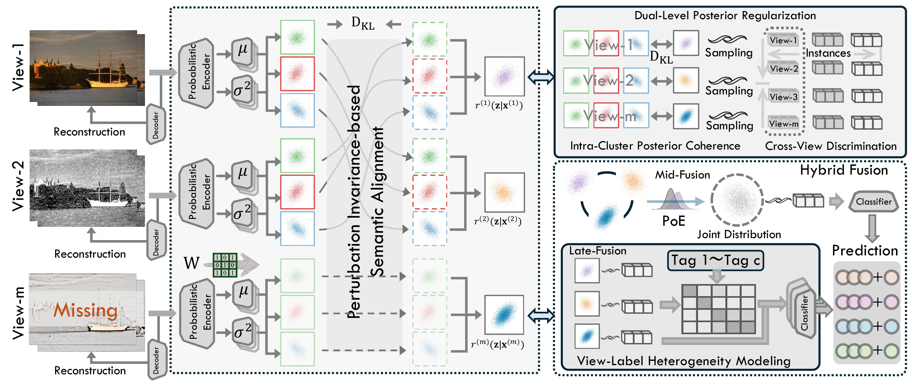
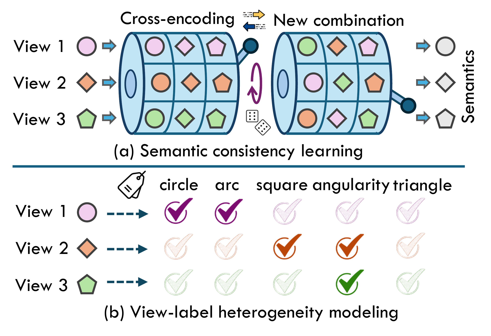
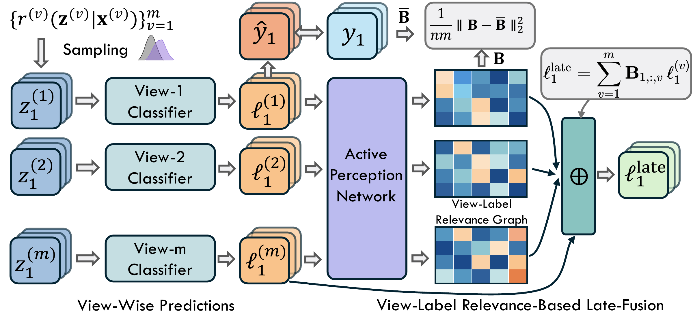

# V2L

### When Semantically Consistent Encoding Meets View-Label Heterogeneity Modeling: A Unified Framework for Incomplete Multi-View Multi-Label Learning

Official PyTorch implementation of **V2L**, published online in **IEEE Transactions on Pattern Analysis and Machine Intelligence (TPAMI), 2026**.

**Chengliang Liu, Bo Li, Bob Zhang, Yanghao Zhou, Jie Wen, and Wenwu Wang**

[Paper (IEEE Xplore)](https://ieeexplore.ieee.org/document/11672278/) · [DOI](https://doi.org/10.1109/TPAMI.2026.3728832) · [Code](https://github.com/justsmart/V2L)

---

V2L learns to predict multiple labels from partially observed views and incomplete label annotations. It combines a shared variational representation with adaptive fusion of individual view predictions. The shared branch captures stable semantics across views, while the decision branch estimates which available views are useful for each label of each instance.

<p align="center">
  
</p>

<p align="center">
  <em><strong>V2L framework.</strong> Semantically consistent encoding provides a shared representation, while adaptive view-label relevance modeling combines complementary view-specific predictions.</em>
</p>

## Highlights

- **Semantically consistent encoding:** source perturbations and cross-view posterior alignment encourage stable, task-relevant latent representations.
- **View-label heterogeneity modeling:** an active relevance network estimates view contributions separately for each instance and label.
- **Hybrid fusion:** shared semantic predictions are combined with label-aware aggregation of view-specific predictions.
- **Incomplete-data learning:** observation masks control feature reconstruction, latent consistency, and supervision from known labels.
- **Five benchmarks:** evaluation covers Corel5k, Pascal07, ESPGame, IAPRTC12, and MIRFLICKR under incomplete and complete settings.

## Method overview

### Motivation

Different views describe the same instance but contribute differently to individual labels. V2L learns consistent semantics across views while preserving the evidence needed for label-specific decisions.

<p align="center">
  
</p>

<p align="center">
  <em><strong>Two complementary motivations.</strong> (a) Semantic consistency across different view combinations. (b) Different views provide different evidence for each label.</em>
</p>

### View-label relevance modeling

The active perception network estimates a relevance graph for each instance. Its label-specific view weights guide the aggregation of individual view predictions, complementing the prediction from the shared representation.

<p align="center">
  
</p>

<p align="center">
  <em><strong>Adaptive view-label fusion.</strong> View-wise predictions support relevance learning, and the learned relevance weights control the contribution of each view to each label.</em>
</p>

## Results

Mean results from Table II of the paper, using **50% missing views**, **50% missing labels**, and a **70%/15%/15% train/validation/test split**, averaged over 10 folds. All displayed metrics are better when larger; the paper also reports standard deviations.

| Dataset | AP | 1-HL | 1-RL | AUC | 1-OE | 1-Cov |
| --- | ---: | ---: | ---: | ---: | ---: | ---: |
| Corel5k | 0.426 | 0.988 | 0.915 | 0.916 | 0.494 | 0.793 |
| Pascal07 | 0.562 | 0.934 | 0.836 | 0.858 | 0.473 | 0.793 |
| ESPGame | 0.321 | 0.983 | 0.853 | 0.857 | 0.467 | 0.638 |
| IAPRTC12 | 0.349 | 0.981 | 0.893 | 0.893 | 0.482 | 0.694 |
| MIRFLICKR | 0.621 | 0.895 | 0.881 | 0.872 | 0.673 | 0.683 |

## Installation

```bash
git clone https://github.com/justsmart/V2L.git
cd V2L

python -m venv .venv
source .venv/bin/activate
pip install torch numpy scipy scikit-learn
```

## Data preparation

Download the experimental datasets from Google Drive:

> [Download MVMLC-DATA](https://drive.google.com/drive/folders/1ey17GpSJEYpYchY6Du_AOj5Yzi2Ml7JU?usp=drive_link)

After downloading, extract the dataset folders and place them under `data/` in the repository root:

```text
data/
├── corel5k/
├── pascal07/
├── espgame/
├── iaprtc12/
└── mirflickr/
```

## Training and evaluation

Run the experiments using the default settings in the code:

```bash
python train_new.py
```

## Repository structure

```text
V2L/
├── images/            # Paper figures and PNG previews used in this README
├── MLdataset.py       # MATLAB data loading, observation masks, and split loaders
├── VAE.py             # Variational encoder building blocks
├── model_VAE_new.py   # Cross-view latent encoding and distribution fusion
├── model_acti.py      # V2L model, relevance prediction, and hybrid fusion
├── myloss_new.py      # Masked supervision and representation regularization
├── train_new.py       # Training, validation selection, and test evaluation
├── evaluation.py      # Multi-label evaluation metrics
├── utils.py           # Logging and result aggregation
└── final_records/     # Created when experiments are run
```

## Citation

If you use V2L in your research, please cite the IEEE TPAMI article:

```bibtex
@article{liu2026v2l,
  author  = {Chengliang Liu and Bo Li and Bob Zhang and Yanghao Zhou and Jie Wen and Wenwu Wang},
  title   = {When Semantically Consistent Encoding Meets View-Label Heterogeneity Modeling: A Unified Framework for Incomplete Multi-View Multi-Label Learning},
  journal = {IEEE Transactions on Pattern Analysis and Machine Intelligence},
  year    = {2026},
  pages   = {1--18},
  doi     = {10.1109/TPAMI.2026.3728832}
}
```

The citation follows the IEEE-registered DOI metadata. Volume and issue are omitted because they are not yet assigned in that record; the DOI identifies the published journal article.
